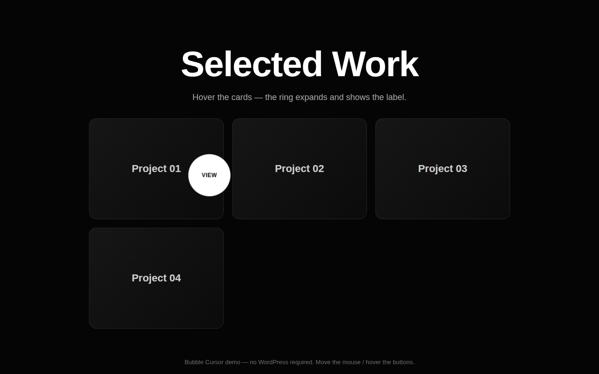

> ## Where this repo fits (added 2026-10-17)
>
> Owner: **zeerebel** (Mark Phu). **Master index of every repo → [REPOS.md in zeerebel/reframe](https://github.com/zeerebel/reframe/blob/main/REPOS.md)** — read it first whenever you are unsure which repo is current.
>
> | | |
> | --- | --- |
> | **What this is** | Bubble Cursor — WordPress plugin, WebGL smoke trail + dot/ring cursor with "View" hover bubble. v1.3.0. Plugin lives in the `bubble-cursor/` subfolder; `demo/`, `Exposure.html` and the screenshot are reference material. |
> | **Status** | **CANONICAL for the standalone plugin** — but the *identical* code is already built into the Reframe theme as Cursor Style "Bubble". |
> | **Planned repo name** | `flux-bubble-cursor` |
> | **With the Reframe theme** | ✅ Use **either** the theme's Cursor Style = Bubble **or** this plugin with the theme cursor Off — never both (two cursors). |
> | **Related repos** | Reframe theme: `zeerebel/reframe` (contains this code in assets/js/bubble-cursor.js); other cursor repos |
# Bubble Cursor — replicating the Deep theme "smokey" cursor

This repo answers a question: **can the cursor on
[preview.treethemes.com/elementor/deep/exposure](https://preview.treethemes.com/elementor/deep/exposure/)
be replicated in WordPress?** Short answer: **yes**, and it's included here as a
ready-to-install plugin.


**Part of the Flux family:** see [FAMILY.md](FAMILY.md) for how the Flux plugins fit together (shared Flux dashboard, support card, one-cursor rule). Final repo name: `flux-bubble-cursor`; it is in the `cursor` group, so only one cursor plugin should be active.

## What that cursor actually is

Reading the saved page (`Exposure.html`), the effect is **two layers** added by
the TreeThemes *Deep* theme, not one:

1. **A WebGL "smoke" fluid trail.** The page loads `smokey-fluid-cursor.min.js`
   with a `deepFluidCursorConfig` of `BLOOM`, `COLORFUL`, `SPLAT_RADIUS`,
   `SPLAT_FORCE`, `DENSITY_DISSIPATION`… — the exact options of the open-source
   [WebGL-Fluid-Simulation by Pavel Dobryakov](https://github.com/PavelDoGreat/WebGL-Fluid-Simulation)
   (MIT licensed), which the [`smokey-fluid-cursor`](https://github.com/faraasat/smokey-fluid-cursor)
   library wraps. This is the colourful smoke you see near the hero.
2. **A custom dot + ring cursor ("demo2").** `deepCursorSettings` defines a
   white dot + ring that follow the mouse, plus a **"View"** label that appears
   when hovering links, buttons, and Elementor containers
   (`wcf_enable_cursor_hover_effect_text`).

Both are standard front-end techniques with **no server dependency**, so they
port cleanly to any WordPress site. The smoke engine is MIT-licensed, so it can
be bundled and redistributed.

## The bonus: it's a plugin

`bubble-cursor/` is a self-contained WordPress plugin that reproduces both
layers and exposes them through a settings screen — **no theme edits, no code**.

| Original (Deep demo) | This plugin |
| --- | --- |
| `smokey-fluid-cursor.min.js` (WebGL fluid) | `assets/js/fluid-cursor.js` (clean MIT port, configured to match) |
| `deepCursorSettings` dot + ring + "View" | `assets/js/bubble-cursor.js` |
| `deep-custom-cursor-*.css` | `assets/css/bubble-cursor.css` |
| Theme options | **Settings → Bubble Cursor** |

### Install

1. Zip the `bubble-cursor` folder (so the zip contains `bubble-cursor/bubble-cursor.php`).
2. WordPress admin → **Plugins → Add New → Upload Plugin** → choose the zip → **Activate**.
3. Open **Settings → Bubble Cursor**. Defaults already match the Deep demo.

You can also just copy the `bubble-cursor` folder into
`wp-content/plugins/` and activate it.

### What you can configure

* Master on/off, and whether it loads site-wide or on the front page only.
* Toggle each layer independently: smoke, ring, dot, and whether to hide the
  native OS cursor (the Deep demo keeps it visible — that's the default).
* Dot / ring colours, the hover word (default **View**), and the hover selector.
* **Shape, size & transparency:** dot size, ring size, ring thickness, cursor
  opacity, and smoke opacity.
* **Smoke physics & intensity:** colourful on/off, bloom glow + intensity,
  smoke intensity/brightness, swirl, splat force, splat radius, density /
  velocity fade, a **Low / Medium / High** quality preset, and a blend mode
  (e.g. *screen* / *lighten* to keep text readable).

### Won't crash your site

The engine is built defensively for live use: GPU framebuffers are freed on
every resize (no memory leak), resize handling is debounced, WebGL context-loss
is handled, and both the render loop and the front-end init are wrapped so a
cursor error fails silently instead of taking the page down. It also stays
off on touch-only devices, respects "reduced motion", and does nothing if the
browser has no WebGL. Since 1.2.0 it also survives hostile host themes and
optimizer plugins (see "Notes on behaviour" below).

### Per-element hover text (optional)

Add an attribute to any element to control the hover bubble:

```html
<a href="/work" data-bubble-cursor-text="Open">My project</a>
<div data-bubble-cursor-hover>Triggers the enlarged ring</div>
```

Elementor containers that already use the **Cursor Hover Effect Text** setting
are detected automatically.

## Try it without WordPress

`demo/index.html` is a standalone page that loads the plugin's real CSS/JS —
open it in any browser (Chrome/Firefox/Safari/Edge) to see the effect with no
WordPress needed:

```bash
# from the repo root
php -S 127.0.0.1:8765
# then visit http://127.0.0.1:8765/demo/index.html
```



## Notes on behaviour

* **Touch devices and touch-screen laptops:** phones and tablets (no hover-capable
  fine pointer) get no cursor. The check is by capability, not by "has a touch
  screen", so a touch-screen laptop with a mouse or trackpad gets the cursor,
  and a device that only reports touch stays dormant and switches on the first
  time a real mouse is moved (taps never do).
* **Page-builder editors:** the cursor is not loaded in the Customizer preview,
  the WPBakery frontend editor (`?vc_editable`), Elementor's preview/editor,
  Divi (`et_fb`), Beaver Builder, Oxygen/Breakdance-style `ct_builder`, or
  Brizy, so it never draws over the editing surface. The
  `bubble_cursor_should_load` filter still lets you decide for other cases.
* **Reduced motion:** if a visitor's OS requests reduced motion, nothing is drawn
  (and the native cursor is never hidden).
* **Hide native cursor:** only applied while the custom cursor is actually
  showing; ignored if both the dot and the ring are off.
* **Optimizers (WP Rocket, LiteSpeed, Rocket Loader, Autoptimize...):** both
  scripts are tagged with the common opt-out attributes, and the settings are
  also mirrored in a `data-bc-settings` attribute on the script tag, so a
  delayed or stripped inline script no longer resets your settings to defaults.
  If neither copy is found the cursor logs one `console.warn` and uses defaults.
* **Cache purge:** saving the settings purges WP Rocket, LiteSpeed, W3 Total
  Cache, Autoptimize and SG Optimizer page caches (each only if installed),
  because settings are baked into the page HTML.
* **Once-only guard:** if the cursor code is loaded twice (a duplicate plugin
  copy, or alongside another cursor), only one set of canvas/dot/ring is
  created, and a second copy of the PHP file returns quietly instead of
  fataling. It is therefore safe if the Reframe theme's built-in **Bubble**
  cursor is also on, but you should still use only one of the two.
* **Host scripts that rewrite `<html class>`:** cursor visibility and hover state
  live on the cursor elements themselves, and the `html.bc-*` marker classes are
  re-applied if a script wipes them.
* **No WebGL:** the smoke silently does nothing; the dot/ring still work.
* **Performance:** the simulation runs at a capped device-pixel-ratio, pauses
  cleanly on page unload, and stops drawing entirely once the pointer has been
  idle long enough for the smoke to fade (it resumes on the next mouse move).
  Back/forward-cache restores rebuild the smoke layer.

## Tests

`tests/` has a Chromium-only Playwright suite and a stubbed-WordPress PHP
harness; run `./tests/run.sh`. See `tests/README.md`. Firefox, Safari and iOS
WebKit are **not** covered by it.

## Credits & license

* Plugin code: GPL-2.0-or-later (matching WordPress).
* Bundled WebGL fluid engine: adapted from
  [WebGL-Fluid-Simulation](https://github.com/PavelDoGreat/WebGL-Fluid-Simulation)
  by Pavel Dobryakov, MIT License — see
  [`bubble-cursor/assets/js/LICENSE-fluid.txt`](bubble-cursor/assets/js/LICENSE-fluid.txt).

`Exposure.html` and the screenshot in this repo are the original reference
material used to identify the effect.

<!-- flux-family:start -->
## The Flux family

This plugin has siblings: the **Flux family** are small WordPress plugins that work on their own and work together, with a shared "Flux" admin dashboard, one support card and one set of rules (see [FAMILY.md](./FAMILY.md)). Only run one custom-cursor plugin at a time.

| Plugin | Repo | Group | Version |
| --- | --- | --- | --- |
| Flux Reel | [`zeerebel/kurato`](https://github.com/zeerebel/kurato) | ui | 1.3.0 |
| Flux Backgrounds | [`zeerebel/flux-backgrounds`](https://github.com/zeerebel/flux-backgrounds) | visual | 0.10.0 |
| Flux Preloader | [`zeerebel/flux-preloader`](https://github.com/zeerebel/flux-preloader) | visual | 1.5.0 |
| Flux Reveal | [`zeerebel/flux-reveal`](https://github.com/zeerebel/flux-reveal) | visual | 1.8.0 |
| Flux Smooth Scroll | [`zeerebel/fluxsmoothscroll`](https://github.com/zeerebel/fluxsmoothscroll) | scroll | 1.3.0 |
| Flux Scroll Progress | [`zeerebel/fluxscrollprogress`](https://github.com/zeerebel/fluxscrollprogress) | scroll | 1.4.0 |
| Flux Jelly Cursor | [`zeerebel/fluxjellycursor`](https://github.com/zeerebel/fluxjellycursor) | cursor | 1.4.0 |
| **Flux Bubble Cursor (this plugin)** | [`zeerebel/bubble_cursor`](https://github.com/zeerebel/bubble_cursor) | cursor | 1.3.0 |
| Super Duper Cursor | [`zeerebel/super-duper-cursor`](https://github.com/zeerebel/super-duper-cursor) | cursor | 3.1.2 |
| Super Duper Cursor Pro | [`zeerebel/super-duper-cursor-pro`](https://github.com/zeerebel/super-duper-cursor-pro) | cursor | 4.3.0 |
<!-- flux-family:end -->
